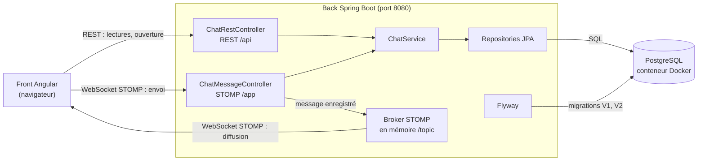

# YCYW - PoC tchat

Preuve de concept (PoC) du **tchat entre un client et un agent du service client** de Your Car Your Way.

Une preuve de concept est un petit programme qui vérifie qu'un choix technique fonctionne, avant de construire l'application complète. Celle-ci vérifie l'architecture annoncée pour la future application :

- **back** (le serveur) : Spring Boot 4.1 en Java 25 ;
- **front** (l'interface dans le navigateur) : Angular 22 ;
- **base de données** : PostgreSQL 18 ;
- **échanges en direct** : WebSocket avec le protocole STOMP (expliqués en [section 6](#6-fonctionnement--le-trajet-dun-message)).

## Sommaire

1. [Ce que la PoC démontre, et ce qu'elle ne fait pas](#1-ce-que-la-poc-démontre-et-ce-quelle-ne-fait-pas)
2. [Prérequis](#2-prérequis)
3. [Installation](#3-installation)
4. [Lancement](#4-lancement)
5. [Démo à deux navigateurs](#5-démo-à-deux-navigateurs)
6. [Fonctionnement : le trajet d'un message](#6-fonctionnement--le-trajet-dun-message)
7. [Structure des données](#7-structure-des-données)
8. [Arborescence commentée](#8-arborescence-commentée)
9. [Dépannage](#9-dépannage)

## 1. Ce que la PoC démontre, et ce qu'elle ne fait pas

### 1.1 Ce qu'elle démontre

Elle couvre l'épique E5 « Support client (tchat) » du cahier des charges :

- un client ouvre une conversation et échange en direct avec le service client ;
- un agent voit les conversations des clients et y répond en direct ;
- le client et l'agent retrouvent l'historique de leurs échanges, enregistré en base de données.

### 1.2 Ce qu'elle ne fait pas, volontairement

Une PoC doit rester limitée à ce qu'elle veut prouver. Ces sujets sont traités dans la proposition d'architecture, pas dans le code :

| Absent de la PoC | Ce que fait la PoC à la place | Où c'est traité |
| --- | --- | --- |
| Connexion avec mot de passe | On choisit « qui je suis » parmi deux utilisateurs de démonstration. N'importe qui peut donc se faire passer pour n'importe qui : c'est assumé pour une démo locale | Proposition d'architecture : authentification avec Spring Security |
| Droits d'accès (un client ne voit que ses conversations) | Le front n'affiche au client que ses conversations, mais le back ne le contrôle pas | Proposition d'architecture : sécurité |
| Plusieurs serveurs en parallèle | Un seul back, qui distribue lui-même les messages | Proposition d'architecture : broker de messages externe |
| Clôture d'une conversation, affectation à un agent | Toute conversation reste ouverte, tous les agents peuvent répondre | Évolutions du tchat |
| Tests automatisés | La vérification se fait par la démo de la [section 5](#5-démo-à-deux-navigateurs) | Proposition d'architecture : stratégie de test |

### 1.3 Correspondance avec le cahier des charges

Le tableau relie chaque user story de l'épique E5 à ce que la PoC montre. Les critères d'acceptation (CA) sont ceux du cahier des charges.

| User story | Ce que la PoC démontre | Laissé de côté volontairement |
| --- | --- | --- |
| US-21 : le client échange en direct avec le service client | Ouverture d'une conversation, message de confirmation (CA1) ; messages affichés avec leur heure et reçus aussitôt par l'agent (CA2, CA3) ; nouveaux messages annoncés aux lecteurs d'écran, tout au clavier (CA5) | Statut « En attente » (CA1) ; invitation à se connecter (CA4), faute d'authentification |
| US-22 : l'agent voit les conversations et répond en direct | Liste des conversations avec le nom du client (CA1) ; nouvelle conversation affichée et annoncée sans recharger la page (CA2, CA5) ; réponse reçue aussitôt par le client (CA4) | Signalement « En attente » (CA1) et prise en charge par un agent (CA3) |
| US-23 : le client et l'agent retrouvent l'historique | Historique rechargé depuis la base (CA1, CA2, CA3) ; chaque message indique en texte son auteur et son heure (CA4) | Durée de conservation des conversations (CA2) |

## 2. Prérequis

Installe ces outils. La commande de la dernière colonne doit afficher la bonne version.

| Outil | Version | Vérifier avec |
| --- | --- | --- |
| Git | 2 ou plus | `git --version` |
| JDK (kit de développement Java, Temurin conseillé) | 25 | `java -version` |
| Node.js | 24 LTS conseillé, 22.22 minimum | `node -v` |
| Docker et Docker Compose | Docker 24 ou plus | `docker compose version` |
| Un éditeur de code | IntelliJ IDEA ou VS Code | - |

Tu n'as pas besoin d'installer Maven ni PostgreSQL :

- Maven, l'outil qui compile le back, est fourni dans `back/` par le *Maven Wrapper* (commande `./mvnw`) ;
- PostgreSQL tourne dans un conteneur Docker, une sorte de mini-machine isolée.

## 3. Installation

### 3.1 Récupérer le code

```bash
git clone <url-du-dépôt> ycyw-chat-poc
cd ycyw-chat-poc
```

Toutes les commandes partent de ce dossier, sauf indication contraire.

### 3.2 Créer le fichier `.env`

Le fichier `.env` contient le mot de passe de la base locale. Il n'est jamais enregistré dans Git : seul son modèle `.env.example` l'est.

```bash
cp .env.example .env
```

Ouvre `.env` et remplace `change-me` par un mot de passe de ton choix.

### 3.3 Installer les dépendances du front

```bash
cd front
npm ci
cd ..
```

`npm ci` installe exactement les versions listées dans `front/package-lock.json`.

## 4. Lancement

Il faut deux terminaux : un pour le back, un pour le front. Docker doit être démarré.

### 4.1 Le back et la base de données (port 8080)

Dans un premier terminal :

```bash
cd back
./mvnw spring-boot:run
```

- Sous Windows, remplace `./mvnw` par `mvnw.cmd`.
- Le premier lancement télécharge les dépendances : compte quelques minutes.
- Le back démarre lui-même la base : le module **Spring Boot Docker Compose** lance le conteneur PostgreSQL décrit dans `compose.yaml`, attend qu'il soit prêt et s'y connecte. À l'arrêt du back (Ctrl+C), le conteneur est arrêté ; les données sont conservées.
- La base démarre vide la première fois. Ce sont les **migrations Flyway** qui la remplissent : Flyway est un outil qui exécute, au démarrage du back, les scripts SQL du dossier `back/src/main/resources/db/migration/`, dans l'ordre de leur numéro et une seule fois chacun.
- Le back est prêt quand la console affiche `Started ChatPocApplication`.
- La documentation de l'API REST est alors consultable sur <http://localhost:8080/swagger-ui.html> (voir [section 6.5](#65-la-documentation-de-lapi-openapi)).

### 4.2 Le front (port 4200)

Dans un second terminal :

```bash
cd front
npm start
```

Ouvre <http://localhost:4200>. Le fichier `front/proxy.conf.json` transmet au back les appels qui commencent par `/api` et `/ws` : le navigateur ne parle qu'à l'adresse `localhost:4200`.

## 5. Démo à deux navigateurs

Place deux fenêtres côte à côte, chacune sur une moitié de l'écran, par exemple Chrome à gauche et Firefox à droite. Deux onglets d'un même navigateur fonctionnent aussi. La liste des conversations est à gauche de chaque fenêtre ; si la fenêtre est très étroite, elle passe au-dessus.

| Étape | Fenêtre de gauche (client) | Fenêtre de droite (agent) |
| --- | --- | --- |
| 1 | Ouvre <http://localhost:4200> et choisis « Camille Martin - client » | Ouvre <http://localhost:4200> et choisis « Alex Durand - agent du service client » |
| 2 | Clique sur « Nouvelle conversation » : un message confirme qu'un conseiller va répondre | La conversation apparaît aussitôt dans « Conversations des clients », et un message l'annonce, sans recharger la page |
| 3 | Écris un message et appuie sur Entrée (essaie aussi avec un champ vide : un message d'erreur s'affiche sous le champ) | Clique sur la conversation : le message du client s'affiche |
| 4 | La réponse de l'agent s'affiche aussitôt | Réponds : le message apparaît des deux côtés |
| 5 | Recharge la page et choisis à nouveau Camille Martin, puis la conversation | L'historique complet est revenu : il vient de la base de données |

Tout l'écran s'utilise au clavier : la touche Tab passe d'un élément à l'autre, Entrée envoie le message, Maj+Entrée va à la ligne.

## 6. Fonctionnement : le trajet d'un message

### 6.1 Deux façons de communiquer avec le back

- **REST** : le front envoie une requête HTTP et reçoit une réponse, comme une page web classique. On l'utilise pour ce qui se lit une fois : la liste des utilisateurs, des conversations, et l'historique.
- **WebSocket** : une connexion qui reste ouverte entre le navigateur et le back. Le back peut ainsi envoyer un message au navigateur sans que celui-ci le demande. On l'utilise pour les messages en direct.
- **STOMP** est un protocole simple qui s'ajoute à la WebSocket. Il permet de s'**abonner** à une adresse (appelée *destination*, par exemple `/topic/conversations/3`) et de recevoir tout ce qui y est publié. Le composant qui distribue les messages aux abonnés s'appelle le **broker** ; ici, il est intégré au back.

### 6.2 Les composants et leurs liens



En mots : le front parle au back de deux façons, REST pour lire et WebSocket STOMP pour le direct. Les deux contrôleurs passent par le même service, qui lit et écrit en base par les repositories. Le broker renvoie chaque message enregistré à tous les navigateurs abonnés. Pendant le développement, le proxy d'Angular (port 4200) transmet ces appels au back.

### 6.3 Le trajet, étape par étape

Exemple : Camille envoie « Bonjour » dans la conversation n° 3.

1. Quand Camille et l'agent ont ouvert la conversation n° 3, deux choses se sont faites dans le front (fichier `front/src/app/app.ts`) :
   - l'historique a été chargé en REST par `history`, un `httpResource` : un signal qui lance la requête HTTP et la relance quand la conversation choisie change ;
   - le front s'est **abonné** à la destination `/topic/conversations/3` dans l'`effect` nommé `liveMessages`. Quand on change de conversation ou d'utilisateur, la fonction passée à `onCleanup` annule cet abonnement : aucun abonnement n'est oublié.
2. Camille appuie sur Entrée. Le formulaire (Signal Forms) vérifie que le message n'est pas vide, puis le front envoie `{"authorId": 1, "content": "Bonjour"}` à la destination `/app/conversations/3/messages` (fichier `chat.service.ts`, méthode `sendMessage`).
3. Dans le back, la méthode `send` de `ChatMessageController` reçoit le message. Spring vérifie d'abord que le contenu n'est pas vide et ne dépasse pas 2 000 caractères.
4. `ChatService.saveMessage` enregistre le message dans la table `message`.
5. La méthode `send` renvoie le message enregistré. L'annotation `@SendTo("/topic/conversations/{id}")` le confie au broker, qui le transmet à tous les abonnés de la conversation n° 3.
6. Le front de Camille et celui de l'agent reçoivent le message et l'ajoutent au signal `live`. Le signal calculé `messages` réunit l'historique et `live`, sans doublon : l'écran se met à jour, et le lecteur d'écran annonce le message grâce au rôle `log` de la zone des messages.

### 6.4 Les adresses utilisées

| Type | Adresse | Rôle |
| --- | --- | --- |
| REST | `GET /api/users` | Liste des utilisateurs de démonstration |
| REST | `GET /api/conversations?userId=1` | Conversations d'un client, ou toutes pour un agent |
| REST | `POST /api/conversations` | Un client ouvre une conversation |
| REST | `GET /api/conversations/{id}/messages` | Historique d'une conversation |
| STOMP, envoi | `/app/conversations/{id}/messages` | Envoyer un message |
| STOMP, abonnement | `/topic/conversations/{id}` | Recevoir les messages d'une conversation |
| STOMP, abonnement | `/topic/conversations` | L'agent reçoit les nouvelles conversations |

### 6.5 La documentation de l'API (OpenAPI)

**OpenAPI** est un format standard qui décrit une API REST : ses adresses, ce qu'elles reçoivent et ce qu'elles renvoient. La bibliothèque **springdoc-openapi** le génère automatiquement à partir des contrôleurs, et l'affiche dans **Swagger UI**, une page web où l'on peut essayer chaque adresse.

- Swagger UI : <http://localhost:8080/swagger-ui.html> (bouton « Try it out » sur chaque adresse) ;
- description brute, au format JSON : <http://localhost:8080/v3/api-docs>.

Seules les adresses REST y figurent : OpenAPI ne décrit pas les échanges STOMP, détaillés dans le tableau ci-dessus. Dans l'application cible, la même bibliothèque documentera l'API destinée aux agences (épique E6 du cahier des charges). Dans la PoC, l'accès n'est pas protégé, comme le reste de l'API.

### 6.6 Accessibilité de l'écran

Elle suit le RGAA (Référentiel général d'amélioration de l'accessibilité) :

- chaque champ a une étiquette visible ; une erreur de saisie est écrite en texte sous le champ, qui est marqué invalide (`aria-invalid`) ;
- la zone des messages porte le rôle `log` : les lecteurs d'écran lisent chaque nouveau message, sans couper la lecture en cours ni déplacer le focus ;
- l'état de connexion et les annonces (nouvelle conversation, conversation ouverte) sont dans des balises `<output>`, lues automatiquement quand leur texte change ;
- tout se fait au clavier, l'élément actif est toujours entouré d'un cadre bien visible, et après « Changer d'utilisateur » le focus revient sur le titre « Qui êtes-vous ? » ;
- aucune information ne repose sur la seule couleur : l'auteur et l'heure de chaque message sont écrits en toutes lettres (« Vous (client), à 15:41 »), et la conversation affichée est aussi en gras.

## 7. Structure des données

Trois tables, créées par la migration `V1__create_tables.sql`. Les deux utilisateurs de démonstration sont ajoutés par `V2__insert_demo_users.sql`.

| Table | Colonne | Type | Rôle |
| --- | --- | --- | --- |
| `app_user` | `id` | nombre, clé primaire | Identifiant unique |
| `app_user` | `display_name` | texte (100) | Nom affiché |
| `app_user` | `role` | texte, `CLIENT` ou `AGENT` | Rôle de l'utilisateur |
| `conversation` | `id` | nombre, clé primaire | Identifiant unique |
| `conversation` | `client_id` | clé étrangère vers `app_user` | Client qui a ouvert la conversation |
| `conversation` | `created_at` | date et heure | Date d'ouverture |
| `message` | `id` | nombre, clé primaire | Identifiant unique, croissant : il donne l'ordre des messages |
| `message` | `conversation_id` | clé étrangère vers `conversation` | Conversation du message |
| `message` | `author_id` | clé étrangère vers `app_user` | Auteur, client ou agent |
| `message` | `content` | texte (2 000), jamais vide | Contenu du message |
| `message` | `sent_at` | date et heure | Date d'envoi |

Quelques notions :

- une **clé étrangère** relie une ligne à une ligne d'une autre table : la base refuse un message dont l'auteur n'existe pas ;
- le schéma respecte la **troisième forme normale (3NF)** : chaque information n'est stockée qu'à un seul endroit. Par exemple, le nom de l'auteur n'est pas recopié dans chaque message, seul son identifiant l'est ;
- la base ne contient **aucune donnée sensible** : ni e-mail, ni mot de passe.

Pour regarder le contenu de la base, pendant que le back tourne :

```bash
docker compose exec postgres psql -U ycyw -d ycyw_chat -c "SELECT * FROM message;"
```

Remplace `ycyw` et `ycyw_chat` si tu as changé `POSTGRES_USER` ou `POSTGRES_DB` dans `.env`.

## 8. Arborescence commentée

```text
ycyw-chat-poc/
├── compose.yaml                 Décrit le conteneur PostgreSQL, démarré par le back
├── .env.example                 Modèle du fichier .env (mot de passe de la base)
├── back/                        Le serveur Spring Boot
│   ├── pom.xml                  Dépendances Maven (dont springdoc-openapi)
│   └── src/main/
│       ├── java/com/ycyw/chat/
│       │   ├── ChatPocApplication.java   Point de démarrage du back
│       │   ├── config/
│       │   │   └── WebSocketConfig.java  Adresse /ws, préfixes /app et /topic, broker
│       │   ├── entity/                   Une classe Java par table (AppUser, Conversation, Message) et l'énumération Role
│       │   ├── repository/               Lecture et écriture en base, une interface par table
│       │   ├── dto/                      Données échangées avec le front (requêtes et réponses)
│       │   ├── service/
│       │   │   └── ChatService.java      Toute la logique du tchat
│       │   └── controller/
│       │       ├── ChatRestController.java     Adresses REST /api/...
│       │       └── ChatMessageController.java  Messages en direct (STOMP)
│       └── resources/
│           ├── application.yaml          Configuration (démarrage de la base avec compose.yaml)
│           └── db/migration/             Scripts Flyway V1 (tables) et V2 (utilisateurs de démo)
└── front/                       L'interface Angular
    ├── proxy.conf.json          Transmet /api et /ws au back
    └── src/app/
        ├── app.ts               L'unique écran : son état (signals) et ses actions
        ├── app.html             L'unique écran : son contenu
        ├── app.css              L'unique écran : sa mise en page
        ├── chat.service.ts      Lectures REST (httpResource), ouverture d'une conversation, connexion STOMP
        └── models.ts            Types des données reçues du back
```

Le back est découpé en couches : le **controller** reçoit les demandes du front, le **service** applique la logique, le **repository** lit et écrit en base, l'**entity** représente une ligne de table. Chaque couche n'appelle que la suivante.

## 9. Dépannage

| Symptôme | Cause probable | Solution |
| --- | --- | --- |
| Le back s'arrête : *Unable to start docker process* ou *Cannot connect to the Docker daemon* | Docker n'est pas démarré | Démarre Docker Desktop ou le service Docker, puis relance le back |
| Le back s'arrête : *required variable POSTGRES_DB is missing* | Pas de fichier `.env` | `cp .env.example .env` ([section 3.2](#32-créer-le-fichier-env)) |
| Le back s'arrête : *port is already allocated* | Un autre PostgreSQL utilise déjà le port 5432 | Arrête-le, ou mets `POSTGRES_PORT=5433` dans `.env` |
| Le back s'arrête : *password authentication failed* | Le mot de passe de `.env` a changé après la création de la base | Recrée la base, ce qui efface ses données : `docker compose down -v` à la racine du dépôt, puis relance le back |
| Le back s'arrête sur une erreur Flyway (*checksum mismatch*, *more than one migration*) | Base ou dossier `target/` créés par une ancienne version du code | Recrée la base comme ci-dessus, puis relance avec `./mvnw clean spring-boot:run` |
| `./mvnw` affiche *release version 25 not supported* | Maven utilise un JDK plus ancien | `java -version` doit afficher 25 |
| L'écran reste sur « Connexion au tchat en cours… » | Le back n'est pas lancé, ou le front n'est pas ouvert sur `localhost:4200` | Vérifie le terminal du back et l'adresse dans le navigateur |
| `npm ci` affiche *install scripts blocked* | npm bloque par défaut certains scripts d'installation | Sans conséquence : `npm start` fonctionne |
